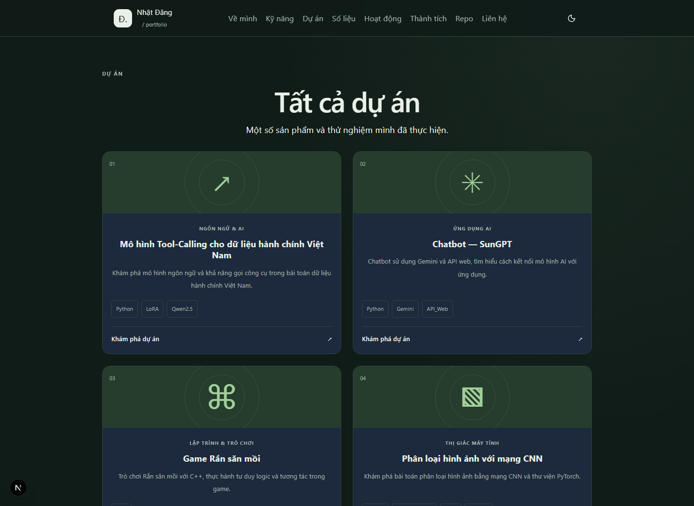

# Nguyễn Nhật Đăng — Portfolio

Portfolio giới thiệu Nguyễn Nhật Đăng, sinh viên Vật lý tin học quan tâm đến AI, dữ liệu và phát triển web. Trang web tổng hợp kỹ năng, dự án, hoạt động và thành tích, đồng thời cung cấp biểu đồ dữ liệu và biểu mẫu liên hệ. Dự án được xây dựng bằng Next.js App Router và hiển thị bằng tiếng Việt.

## Liên kết

- **Production:** Chưa có URL production được cấu hình.
- **Tài khoản demo:** Không cần đăng nhập; ứng dụng hiện không có chức năng xác thực người dùng.
- **Mã nguồn:** [FireHaru/portfolio-next](https://github.com/FireHaru/portfolio-next)

## Ảnh chụp màn hình

### Trang chủ


### Danh sách dự án



## Công nghệ chính

| Công nghệ | Phiên bản |
| --- | --- |
| Node.js | 24 |
| Next.js | 16.4.6 |
| React / React DOM | 19.3.0 |
| TypeScript | 5.9.3 |
| Tailwind CSS | 4.3.3 |
| ESLint | 9.39.5 |
| Radix UI | 1.8.1 |

## Checklist tính năng

Checklist này tổng hợp các tính năng hiện có trong repository; đề bài chưa cung cấp rubric riêng.

- ✅ Các mục giới thiệu, kỹ năng, dự án, hoạt động, thành tích và liên hệ.
- ✅ Tìm kiếm, lọc theo công nghệ và sắp xếp tên các dự án nổi bật.
- ✅ Trang danh sách tất cả dự án và trang chi tiết từng dự án.
- ✅ Biểu đồ dữ liệu cho phép chọn điểm đo và điều chỉnh số điểm hiển thị.
- ✅ Chuyển đổi giao diện sáng/tối.
- ✅ Hiển thị các repository công khai từ GitHub.
- ✅ Kiểm tra dữ liệu biểu mẫu liên hệ và gửi tin nhắn qua FormSubmit.
- ❌ Chưa có kiểm thử tự động bằng Vitest hoặc Playwright.

## Chạy dự án trên máy cá nhân

Cần Node.js 24 và npm. Đây là portfolio frontend, không sử dụng cơ sở dữ liệu, Prisma hoặc biến môi trường; vì vậy repository hiện không có `.env.example` hay lệnh migrate/seed.

```bash
npm ci
npm run dev
```

Mở [http://localhost:3000](http://localhost:3000).

## Chạy kiểm thử và kiểm tra

Hiện tại, `package.json` chỉ định nghĩa lệnh lint:

```bash
npm run lint
```

Các package cần thiết để chạy `npx vitest run` và `npx playwright test` chưa được cài đặt; `package.json` cũng chưa có script kiểm thử. Lệnh `npm run typecheck` chưa được định nghĩa.

## Quyết định kỹ thuật và giới hạn đã biết

- Dự án sử dụng Next.js App Router; dữ liệu dự án được lưu trực tiếp trong mã nguồn, không dùng cơ sở dữ liệu.
- Mục repository GitHub lấy dữ liệu từ GitHub API và cần kết nối internet.
- Biểu mẫu liên hệ gửi tin nhắn qua dịch vụ bên thứ ba FormSubmit; việc gửi phụ thuộc vào kết nối mạng và tình trạng hoạt động của dịch vụ.
- Repository chưa có URL production được xác nhận hoặc tài khoản demo.

## Nhật ký sử dụng AI

Xem tóm tắt các thay đổi và việc sử dụng AI tại [AI_LOG.md](AI_LOG.md).
